# Kit visual eduAssets

Assets vetoriais (SVG, 54 arquivos) derivados da identidade do eduAssets: símbolo do notebook com a seta, "Assets" em azul (`#3B82F6` → `#1D4ED8`), fundos azul-marinho com brilho e a paleta de `src/styles/base/variables.css`. Todos têm `<title>`/`aria-label`, não dependem de fontes externas e pesam poucos KB.

## Onde já são usados no app

- **Estados vazios:** Devoluções sem nada em aberto (`tudo-devolvido`), buscas sem resultado (`busca-sem-resultados`), Controle sem registros (`sem-ocorrencias`) e estoque vazio no Dashboard (`sem-equipamentos`).
- **Erro de carga:** `erro-conexao`; **página 404:** `pagina-nao-encontrada`.
- **Ícones de equipamento:** ao lado de cada modelo no estoque do Dashboard e em Cadastros → Equipamentos, escolhidos pelo nome da categoria (`src/shared/components/kitVisual.ts`).
- **Favicon:** `favicon.svg` é a base dos ícones do app e do site.

## Como usar

```html
<!-- Ilustração decorativa: alt vazio -->

<!-- Ícone com significado: alt descritivo -->

```

```css
.area-com-textura { background: var(--bg-light) url("/assets/kit/padroes/pontos.svg"); }
.capa { background: url("/assets/kit/padroes/brilho-hero.svg") center / cover; }
```

- **Qual símbolo usar:** `simbolo-cor` em fundo claro; `simbolo-sobre-escuro` em fundo escuro; `simbolo-mono-escuro` / `simbolo-mono-claro` para impressão, carimbos ou fundos com foto.
- **Favicon:** `favicon.svg` é o símbolo simplificado para 16–64 px, com contorno duplo (halo branco + borda marinho) que o separa de qualquer fundo; as cores ficam mais claras quando o navegador está no tema escuro. Os PNG/ICO do app e do site saem dele.
- **Ícones de app:** `app-icone-escuro` (padrão, combina com a barra lateral) e `app-icone-claro`. Para PWA/favicon em PNG, exporte deles no tamanho necessário.
- **Avatares:** para escolher um avatar estável por pessoa, use `pessoa-0N` com `N = (id % 8) + 1`.
- **Tema:** as cores são fixas no arquivo (SVG em `` não lê as variáveis CSS da página); todas as peças foram conferidas sobre `--surface-white` (claro) e `--slate-800` (escuro).

## Paleta usada

| Uso | Cor |
| --- | --- |
| Azul do logotipo | `#3B82F6` → `#1D4ED8` |
| Traço de ilustrações e ícones | `#4A7DF2` (preenchimento a 14–16%) |
| Primária (tema) | `#2563EB`, `#5C8AF4`, `#8FB0F8`, `#B8CFFB` |
| Fundos escuros | `#050B1C`, `#10182C`, `#112C6B`, `#143789` |
| Destaques | sucesso `#43A047`, atenção `#F57C3A`, erro `#E5484D`, violeta `#8B5CF6` |

## Logo e símbolo (`logo/`, 7)

Símbolo (notebook + seta ascendente: o ciclo empréstimo → devolução), favicon com contorno e ícones de app.

<figure style="display:inline-block;margin:6px;text-align:center">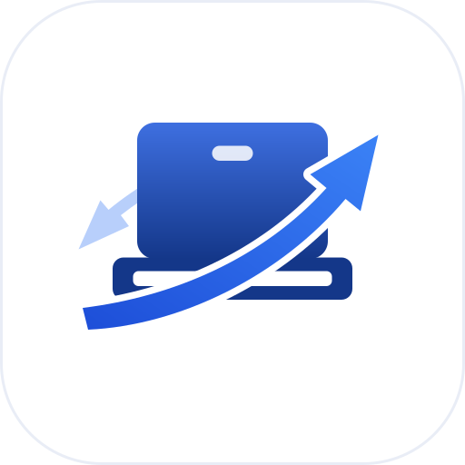<figcaption><code>app-icone-claro.svg</code></figcaption></figure><figure style="display:inline-block;margin:6px;text-align:center">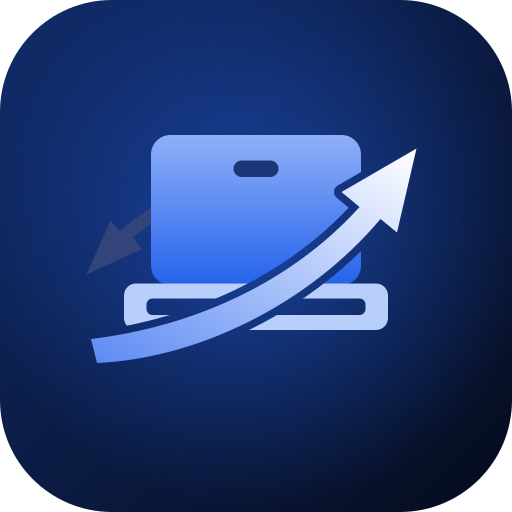<figcaption><code>app-icone-escuro.svg</code></figcaption></figure><figure style="display:inline-block;margin:6px;text-align:center"><figcaption><code>favicon.svg</code></figcaption></figure><figure style="display:inline-block;margin:6px;text-align:center">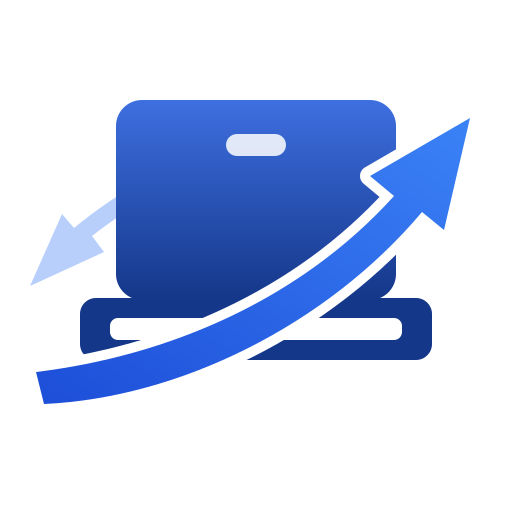<figcaption><code>simbolo-cor.svg</code></figcaption></figure><figure style="display:inline-block;margin:6px;text-align:center"><figcaption><code>simbolo-mono-claro.svg</code></figcaption></figure><figure style="display:inline-block;margin:6px;text-align:center">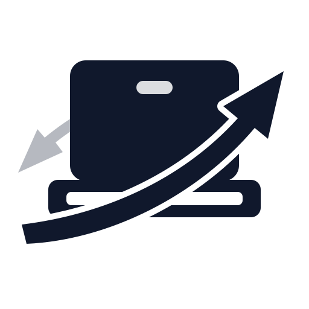<figcaption><code>simbolo-mono-escuro.svg</code></figcaption></figure><figure style="display:inline-block;margin:6px;text-align:center">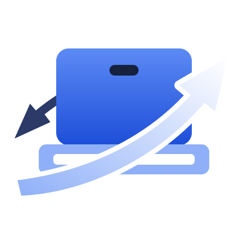<figcaption><code>simbolo-sobre-escuro.svg</code></figcaption></figure>

## Ilustrações (`ilustracoes/`, 14)

Estados vazios e situações do sistema (240 × 180). Traço `#4A7DF2` e preenchimentos translúcidos: funcionam no tema claro e no escuro sem variação.

<figure style="display:inline-block;margin:6px;text-align:center"><figcaption><code>acesso-restrito.svg</code></figcaption></figure><figure style="display:inline-block;margin:6px;text-align:center">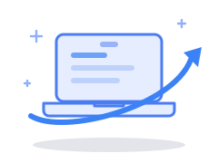<figcaption><code>boas-vindas.svg</code></figcaption></figure><figure style="display:inline-block;margin:6px;text-align:center">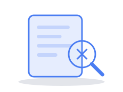<figcaption><code>busca-sem-resultados.svg</code></figcaption></figure><figure style="display:inline-block;margin:6px;text-align:center">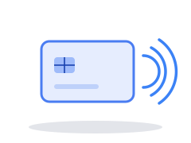<figcaption><code>cartao-rfid.svg</code></figcaption></figure><figure style="display:inline-block;margin:6px;text-align:center"><figcaption><code>erro-conexao.svg</code></figcaption></figure><figure style="display:inline-block;margin:6px;text-align:center">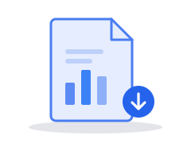<figcaption><code>exportar-relatorio.svg</code></figcaption></figure><figure style="display:inline-block;margin:6px;text-align:center"><figcaption><code>manutencao.svg</code></figcaption></figure><figure style="display:inline-block;margin:6px;text-align:center">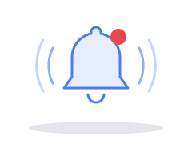<figcaption><code>notificacoes.svg</code></figcaption></figure><figure style="display:inline-block;margin:6px;text-align:center"><figcaption><code>pagina-nao-encontrada.svg</code></figcaption></figure><figure style="display:inline-block;margin:6px;text-align:center"><figcaption><code>sem-emprestimos.svg</code></figcaption></figure><figure style="display:inline-block;margin:6px;text-align:center">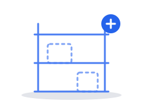<figcaption><code>sem-equipamentos.svg</code></figcaption></figure><figure style="display:inline-block;margin:6px;text-align:center"><figcaption><code>sem-ocorrencias.svg</code></figcaption></figure><figure style="display:inline-block;margin:6px;text-align:center"><figcaption><code>tudo-certo.svg</code></figcaption></figure><figure style="display:inline-block;margin:6px;text-align:center">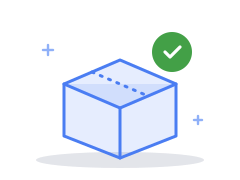<figcaption><code>tudo-devolvido.svg</code></figcaption></figure>

## Ícones de equipamentos (`equipamentos/`, 16)

Duotom, 48 × 48, traço 2,2 px. Complementam os Material Symbols da interface quando se quer um ícone ilustrativo de categoria.

<figure style="display:inline-block;margin:6px;text-align:center">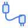<figcaption><code>cabo.svg</code></figcaption></figure><figure style="display:inline-block;margin:6px;text-align:center"><figcaption><code>caixa-de-som.svg</code></figcaption></figure><figure style="display:inline-block;margin:6px;text-align:center"><figcaption><code>camera.svg</code></figcaption></figure><figure style="display:inline-block;margin:6px;text-align:center"><figcaption><code>carregador.svg</code></figcaption></figure><figure style="display:inline-block;margin:6px;text-align:center"><figcaption><code>extensao.svg</code></figcaption></figure><figure style="display:inline-block;margin:6px;text-align:center"><figcaption><code>fone.svg</code></figcaption></figure><figure style="display:inline-block;margin:6px;text-align:center"><figcaption><code>microfone.svg</code></figcaption></figure><figure style="display:inline-block;margin:6px;text-align:center"><figcaption><code>monitor.svg</code></figcaption></figure><figure style="display:inline-block;margin:6px;text-align:center">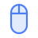<figcaption><code>mouse.svg</code></figcaption></figure><figure style="display:inline-block;margin:6px;text-align:center"><figcaption><code>notebook.svg</code></figcaption></figure><figure style="display:inline-block;margin:6px;text-align:center"><figcaption><code>projetor.svg</code></figcaption></figure><figure style="display:inline-block;margin:6px;text-align:center"><figcaption><code>roteador.svg</code></figcaption></figure><figure style="display:inline-block;margin:6px;text-align:center"><figcaption><code>smartphone.svg</code></figcaption></figure><figure style="display:inline-block;margin:6px;text-align:center"><figcaption><code>tablet.svg</code></figcaption></figure><figure style="display:inline-block;margin:6px;text-align:center"><figcaption><code>teclado.svg</code></figcaption></figure><figure style="display:inline-block;margin:6px;text-align:center"><figcaption><code>webcam.svg</code></figcaption></figure>

## Avatares (`avatares/`, 13)

Pessoas abstratas na paleta da marca, avatares por papel (administrador, editor, convidado, sistema) e o avatar vazio.

<figure style="display:inline-block;margin:6px;text-align:center"><figcaption><code>papel-administrador.svg</code></figcaption></figure><figure style="display:inline-block;margin:6px;text-align:center">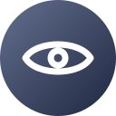<figcaption><code>papel-convidado.svg</code></figcaption></figure><figure style="display:inline-block;margin:6px;text-align:center">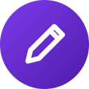<figcaption><code>papel-editor.svg</code></figcaption></figure><figure style="display:inline-block;margin:6px;text-align:center"><figcaption><code>papel-sistema.svg</code></figcaption></figure><figure style="display:inline-block;margin:6px;text-align:center"><figcaption><code>pessoa-01-azul.svg</code></figcaption></figure><figure style="display:inline-block;margin:6px;text-align:center"><figcaption><code>pessoa-02-violeta.svg</code></figcaption></figure><figure style="display:inline-block;margin:6px;text-align:center"><figcaption><code>pessoa-03-verde.svg</code></figcaption></figure><figure style="display:inline-block;margin:6px;text-align:center"><figcaption><code>pessoa-04-laranja.svg</code></figcaption></figure><figure style="display:inline-block;margin:6px;text-align:center"><figcaption><code>pessoa-05-ciano.svg</code></figcaption></figure><figure style="display:inline-block;margin:6px;text-align:center">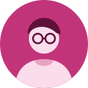<figcaption><code>pessoa-06-rosa.svg</code></figcaption></figure><figure style="display:inline-block;margin:6px;text-align:center"><figcaption><code>pessoa-07-indigo.svg</code></figcaption></figure><figure style="display:inline-block;margin:6px;text-align:center"><figcaption><code>pessoa-08-ardosia.svg</code></figcaption></figure><figure style="display:inline-block;margin:6px;text-align:center">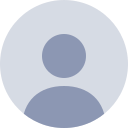<figcaption><code>vazio.svg</code></figcaption></figure>

## Padrões e fundos (`padroes/`, 4)

`pontos` e `grade` são ladrilhos para `background-repeat`; `orbitas` é decorativo (cantos, cabeçalhos); `brilho-hero` reproduz o fundo azul do banner.

<figure style="display:inline-block;margin:6px;text-align:center"><figcaption><code>brilho-hero.svg</code></figcaption></figure><figure style="display:inline-block;margin:6px;text-align:center"><figcaption><code>grade.svg</code></figcaption></figure><figure style="display:inline-block;margin:6px;text-align:center">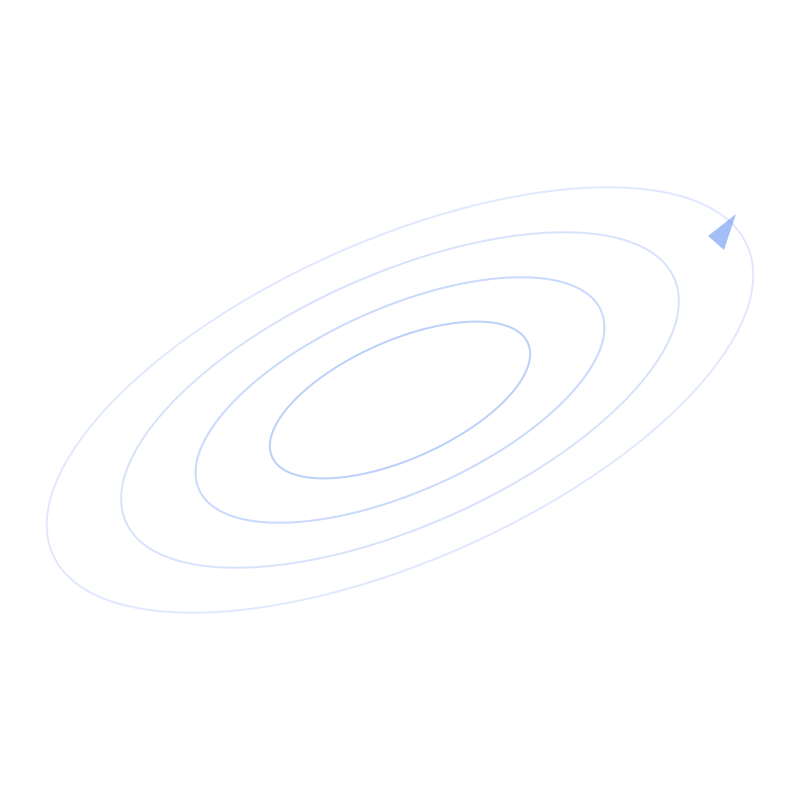<figcaption><code>orbitas.svg</code></figcaption></figure><figure style="display:inline-block;margin:6px;text-align:center"><figcaption><code>pontos.svg</code></figcaption></figure>
